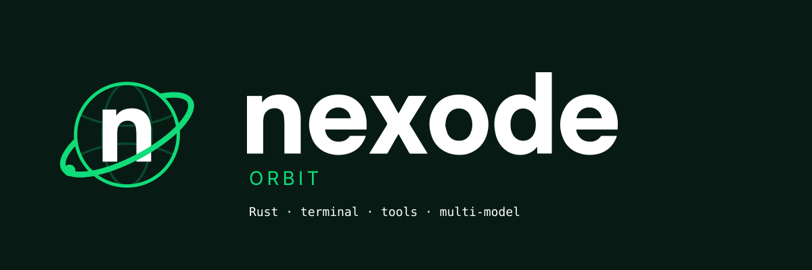

<p align="center">
  
</p>

# Nexode Orbit

Agente de programación en Rust con interfaz de terminal, herramientas, sesiones persistentes, múltiples proveedores y coordinación de agentes.

Repositorio: [lucast1574/nexode-orbit](https://github.com/lucast1574/nexode-orbit).

Esta es la distribución de **Nexode Orbit**. Es independiente del monorepo de [Nexode Cloud](https://github.com/ronnaldrangel/nexode): comparte su identidad visual, pero las APIs de cuenta, suscripciones y despliegue todavía no están integradas con ese backend.

## Compilar y ejecutar

```sh
cargo build --locked --release --bin nexode
./target/release/nexode --version
./target/release/nexode --help
./target/release/nexode
```

En Windows, el binario es `target\release\nexode.exe`. Consulta [Windows](docs/WINDOWS.md) para los requisitos y [Contributing](CONTRIBUTING.md) para dependencias de desarrollo.

Para instalar una compilación local en el PATH del usuario en Linux/macOS:

```sh
bash scripts/install_release.sh --fast
```

El comando es `nexode`, la configuración se guarda en `~/.nexode` y las variables específicas usan el prefijo `NEXODE_`. El directorio puede cambiarse con `NEXODE_HOME`. No se importa automáticamente configuración de otras distribuciones.

## Estructura

| Carpeta | Contenido |
| --- | --- |
| `src/` | CLI y comandos |
| `crates/` | Runtime, proveedores, herramientas, transporte, almacenamiento y TUI |
| `sdk/` | SDK Rust/TypeScript y empaquetado por plataforma |
| `assets/brand/` | Logos SVG, banner y contrato de marca |
| `assets/app-icons/` | Iconos PNG, Windows ICO y macOS ICNS |
| `scripts/` | Compilación, instalación y validación |
| `docs/` | Documentación técnica y guía de esta distribución |

## Lenguajes y dependencias auxiliares

El núcleo, la CLI y la TUI están en Rust. El repositorio también conserva:

- **Python:** pruebas, benchmarks, auditorías y algunas funciones auxiliares, como la exploración de directorios remotos en la TUI. No todo su uso se limita al desarrollo.
- **Bash/Shell:** instalación, compilación, empaquetado y pruebas. La herramienta de comandos ejecuta Bash en Unix y `cmd.exe` en Windows.
- **PowerShell:** instalación, desinstalación y comprobaciones específicas de Windows.
- **JavaScript/TypeScript:** SDK para integrar el agente en otras aplicaciones y pruebas. El worker de telemetría heredado fue eliminado. El puente externo del navegador también usa una extensión JavaScript.

El proyecto tiene un núcleo Rust, pero no es un repositorio exclusivamente Rust. Los scripts de mantenimiento pueden migrarse gradualmente sin confundirlos con el runtime principal.

## Estado de esta distribución

- Nombre, comando, namespaces, crates, SDKs y rutas adaptados a Nexode.
- Logo e icono tomados del monorepo Nexode, commit `f913b50`.
- Acento verde y motivo orbital en la terminal.
- Telemetría desactivada.
- Actualización automática desactivada hasta configurar `NEXODE_RELEASE_REPO` al compilar.
- Paquetes npm privados hasta decidir su publicación y confirmar el namespace.
- Endpoints `*.nexode.invalid` deliberadamente no operativos para servicios pendientes. No son el backend de Nexode Cloud.
- El puente de navegador sigue siendo externo, con extensión JavaScript. El control nativo del escritorio incluido sigue limitado a macOS.

Los videos y capturas originales no se presentan como demos de Nexode. Esta copia no incluye una aplicación desktop gráfica separada.

## Validación

```sh
cargo fmt --all -- --check
cargo check --locked --all-targets --all-features
cargo clippy --locked --all-targets --all-features -- -D warnings
python3 scripts/check_branding.py
```

Consulta [la guía del rebranding](docs/REBRANDING.md) y [el contrato visual](assets/brand/DESIGN.md).

## Licencia

MIT. Se conserva íntegra la licencia original y sus atribuciones en [LICENSE](LICENSE) y [NOTICE](NOTICE).
